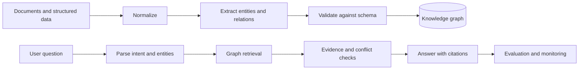

# Knowledge Graph Learning Project

## Purpose

This repository is a learning project for becoming an AI engineer by building a
small, production-shaped knowledge graph application. Teach while implementing:
explain the concept first, show the smallest useful code change, ask the learner
to predict the result, then verify it with a test or an observable example.

Do not hide important decisions behind libraries. Every new dependency must be
explained in terms of the problem it solves, its alternatives, and its
production trade-offs.

## Learning outcome

By the end, the learner should be able to:

- explain entities, relationships, properties, nodes, edges, schemas, and
  graph queries;
- distinguish a knowledge graph from a document store, vector database, and
  relational database;
- build a retrieval-augmented question-answering system using graph traversal;
- identify where data came from and justify an answer with evidence;
- evaluate extraction, retrieval, answer quality, freshness, latency, and cost;
- recognize when an answer is unsupported and safely say “I don't know”;
- describe a path from prototype to production.

## Core concept: knowledge graph

A knowledge graph represents knowledge as connected facts:

```text
(Person: "Asha") -[WORKS_AT]-> (Company: "Acme")
(Asha)            -[USES]->     (Tool: "PostgreSQL")
(Acme)            -[HAS_POLICY]-> (Policy: "Remote Work")
```

In a fact, the subject and object are nodes and the predicate is an edge:

```text
subject --predicate--> object
```

Nodes and edges may have properties such as `source`, `confidence`,
`created_at`, and `valid_until`. The graph is useful because relationships can
be queried and followed, not merely matched by text similarity.

## Project: Acme Engineering Knowledge Assistant

Build an assistant that answers questions about a fictional engineering
organization:

- people and teams;
- services and their owners;
- technologies used by services;
- incidents and their timelines;
- policies and documentation;
- dependencies between services.

Example question:

> Who owns the payments service, what does it depend on, and which incidents
> affected it in the last six months?

A good answer must include:

1. the answer in plain language;
2. the graph path or facts used;
3. source documents and timestamps;
4. an uncertainty note when facts conflict or are missing.

## Target architecture



Start with a local, simple implementation. Use an in-memory graph or SQLite
representation first; only introduce Neo4j, RDF, or another graph database
after the data model and queries are understood. The design must keep storage
replaceable.

## Required teaching workflow

For each task, follow this sequence:

1. **Concept** — explain the idea in simple language and compare it with a
   familiar alternative.
2. **Design** — state the entities, relationships, assumptions, and failure
   modes before coding.
3. **Implement** — make the smallest vertical slice that can be executed.
4. **Inspect** — show sample nodes, edges, query results, and evidence.
5. **Challenge** — give the learner one short prediction or debugging question.
6. **Verify** — run focused tests and explain what they prove and do not prove.
7. **Record** — update the learning log with the lesson, decision, and
   unresolved question.

Never claim that a generated answer is correct merely because it sounds
plausible. Correctness requires matching the answer to authoritative evidence.

## Milestones

### 1. Graph fundamentals

Create a tiny dataset and implement nodes, directed edges, properties, and a
two-hop traversal. Explain why an edge direction and relationship name matter.

### 2. Schema and ingestion

Define a schema for people, teams, services, incidents, and technologies.
Load hand-written JSON/CSV fixtures. Reject malformed records and preserve
source metadata.

### 3. Entity and relation extraction

Extract facts from a few documents. Begin with deterministic rules and typed
validation before using an LLM. Store the original text span for every
extracted fact so it can be audited.

### 4. Retrieval and answering

Convert a question into entities, relationships, filters, and time constraints.
Retrieve a small evidence subgraph. Generate an answer only from retrieved
facts and attach citations.

### 5. Evaluation

Create a gold set of questions with expected answers and expected evidence.
Measure retrieval recall, answer faithfulness, citation correctness,
unsupported-claim rate, latency, and cost.

### 6. Production readiness

Add versioned ingestion, idempotency, freshness checks, conflict handling,
access control, structured logs, tracing, retries with limits, and a rollback
plan. Document what happens when the graph has no answer.

## Evaluation rules

Maintain a dataset with:

```text
question
expected_answer
required_entities
required_relationships
gold_sources
acceptable_variants
```

At minimum, report:

- **retrieval recall**: did retrieval contain the facts needed for the answer?
- **answer faithfulness**: is every material claim supported by retrieved facts?
- **citation precision**: do cited sources actually support the claim?
- **unsupported-claim rate**: how often does the system invent or overreach?
- **coverage**: how often can it answer supported questions?
- **p95 latency and cost**: is it usable and affordable?

Test adversarial cases: missing entities, ambiguous names, stale facts,
contradictory sources, permissions, time ranges, and questions outside the
graph. Prefer a safe refusal over an unsupported answer.

## Production workflow

```text
Ingest -> Normalize -> Extract -> Validate -> Deduplicate -> Version
       -> Write graph -> Index -> Retrieve -> Verify evidence -> Answer
       -> Log -> Evaluate -> Monitor -> Improve
```

Every fact should be traceable to a source and have a lifecycle. Decide how
updates, deletions, conflicting owners, expired policies, and reprocessing are
handled before calling the system production-ready.

## Definition of done for each feature

- The learner can explain the feature without copying its implementation.
- The data model and assumptions are documented.
- At least one happy-path and one failure-path test exist.
- Answers expose evidence and do not silently invent missing facts.
- Evaluation results are reproducible from checked-in fixtures.
- Logs contain identifiers and timings, but never secrets or unnecessary
  sensitive data.
- The learning log records what was learned and what remains uncertain.

## Working agreement for the coding agent

Keep changes small and focused. Prefer clear Python and standard-library
solutions in the first iteration. Use type hints, explicit validation, and
tests. Explain errors instead of swallowing them. Do not add a framework or
hosted service until a concrete requirement justifies it.

At the end of each implementation task, report:

```text
Concept learned:
Code changed:
Evidence inspected:
Tests run:
What can still be wrong:
Next concept:
```

